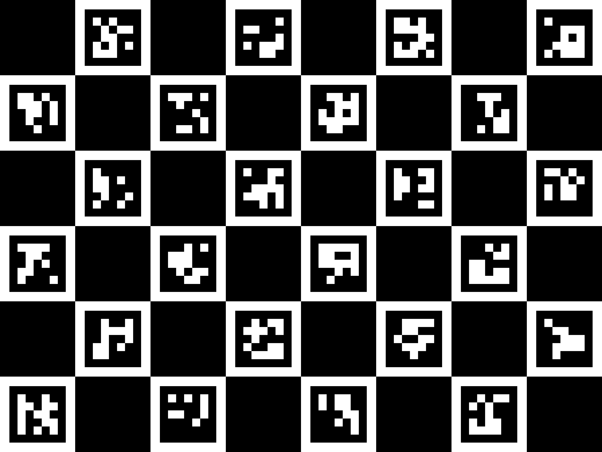

# 2026-09-06: Stereo ORB-SLAM3 Bring-Up, Calibration, and the Case for Lightweight VIO

**Total time spent: Not recorded**

This entry covers the `slam_test/` subsystem, which landed in a single commit (`39d140b`, "Positional Tracking and Calibration") on top of the earlier project-level README work. Everything below is reconstructed from what is actually in the repo — source files, docstrings, config files, and generated artifacts — plus results that were actually measured against this hardware during development. No hour count is available for this session, so it's left as not recorded rather than guessed.

## Starting point

Before `slam_test/` existed, the repo already had `camera.py`, `fast_camera.py`, and `calibrator.py` at the project root. These are a hand-tuned fisheye perspective-correction pipeline: a threaded USB capture loop, an equidistant-fisheye-to-pinhole remap built from manually-tuned FOV/K1-K4 slider values, and a slider-based calibration UI (`calibrator.py`) that saves those slider values to `novex_calibration.json`.

That tooling is a visual correction only. It was never fitted against a target of known physical size, it describes one lens with no relationship between the two eyes, and it cannot produce a stereo baseline. The `slam_test/` work explicitly does not reuse those values for anything metric — this distinction gets written into `slam_test/README.md` and enforced in code (`calibration.py`'s `TemporaryLensModel` vs `StereoCalibration` classes are kept structurally separate, and `TemporaryLensModel` has no `baseline` attribute at all).

## Building a real ORB-SLAM3 test rig

The goal for `slam_test/` was a working ORB-SLAM3 stereo test with a real GUI — not a fake trajectory generator. That meant actually cloning and building upstream ORB-SLAM3 (UZ-SLAMLab) from source, which turned out to need several patches before it would compile at all on a current toolchain (`scripts/patch_orbslam3.py`):

- `cmake_minimum_required(2.8)` → bumped to 3.16 (CMake ≥3.27 refuses anything below 3.5).
- `-std=c++11` → `-std=c++14` (the bundled Sophus/g2o need it).
- `-fPIC` forced everywhere, since the whole thing gets linked into a Python extension module via pybind11.
- Missing `<cstdint>` includes for gcc 13 in five headers.
- The ~70 dataset example executables stripped from the build — only `libORB_SLAM3.so` is needed.

Two of the patches are actual upstream bugs, not toolchain compatibility shims:

1. **`Settings::readCamera2()` reads the right camera's Kannala-Brandt distortion from `Camera1.k1..k4` instead of `Camera2.k1..k4`.** Copy-paste bug — the right lens silently gets modeled with the left lens's distortion.
2. **`Camera.type: "Rectified"` + `STEREO` segfaults on startup.** `readCamera2()` never allocates a camera-2 model for the Rectified type (correct — a rectified pair shares one set of intrinsics), but `Settings::operator<<` dereferences `originalCalib2_` unconditionally whenever the sensor is `STEREO`, and the constructor never initializes that pointer. Since `System`'s constructor prints the settings on startup, this crashes on *every* rectified stereo configuration — including upstream's own KITTI example config. Fixed by initializing the pointer and guarding the print.

A pybind11 binding (`native/orbslam3_binding.cpp`) wraps `ORB_SLAM3::System` and exposes `track_stereo()`, tracking state, tracked keypoints (including per-keypoint stereo match / depth info pulled directly from `Tracking::mCurrentFrame`), and the live map (points + keyframes) back to Python as numpy arrays.

With that in place, ORB-SLAM3 actually initialized and tracked on real captured frames — the pipeline produces genuine map points and keyframes, not simulated ones (`SlamWorker` in `slam.py` reads `system_->GetTrackingState()` and the real tracked map points on every frame; there's no synthetic trajectory generator anywhere in the code path).

## Calibration: the board was too small, then the solver started crashing

The camera is a GXIVISION-LSM22100 stereo module — 2560×720 combined MJPEG frame, 3.0×3.0 µm pixels, ~1.3 mm fisheye lenses. A first calibration attempt used a small printed chessboard and struggled with detection, which led to switching to a ChArUco board (`charuco.py`) instead of a plain chessboard — ChArUco tolerates partial views (the board hanging off the edge of frame), which a plain chessboard cannot, and edge coverage matters specifically because the lens is measured at somewhere around 160-170° horizontal FOV, so distortion at the frame edges is exactly where the model most needs data.

`calibrate_stereo.py` captures ChArUco pairs and fits per-eye fisheye intrinsics with `cv2.fisheye.calibrate`, then recovers the stereo extrinsics (R, T) from per-view board poses rather than `cv2.fisheye.stereoCalibrate` — because `stereoCalibrate` requires a uniform corner count across all views, and ChArUco's whole advantage is *variable* corner counts from partial views.

Two real problems showed up once enough pairs had been captured (`slam_test/calibration/pairs/` currently holds 164 PNGs — 82 stereo pairs — from these sessions):

**The baseline kept coming out physically impossible.** The GXIVISION module is 100 mm wide end to end, so the two lens centers cannot be more than ~100 mm apart. Multiple calibration runs measured 108-111 mm. The current committed calibration (`config/stereo_calibration.yaml`) still reads `baseline_m: 0.1104` (110.4 mm) against a configured `max_baseline_m: 0.095`. This is **not resolved** — the geometry (rotation between eyes, relative scale in board-square units) checks out consistently across independent capture sessions, which means the *shape* of the calibration is probably right, but the declared `square_size_m: 0.0398` is very likely wrong for the physically printed board. The code now treats this as an "unverified scale" condition rather than silently trusting it or blocking on it — `calibration_status()` returns `OK` with a loud warning, `main.py` reports it, and the GUI colors the pose numbers amber — but the actual fix (measure the printed square, or the lens-to-lens gap, with a ruler) hasn't happened yet.

**`cv2.fisheye.calibrate()` started crashing** with `Assertion failed (fabs(norm_u1) > 0) in function 'InitExtrinsics'` once enough views accumulated. This is where the investigation took a few wrong turns worth recording:

- First hypothesis: a view with too few corners. Wrong — a crafted test view with 15 corners spread across 15 board columns but only 1 row reproduced the crash reliably, proving corner *count* alone can't predict it. What matters is whether the corners are geometrically collinear (in board-object space), which has no correlation with corner count.
- Built `view_quality.py` with a geometric degeneracy check (`spread_ratio`, `grid_rank`) that measures how two-dimensional a view's corners actually are, plus checks for insufficient left/right correspondence, extreme board tilt, and near-duplicate poses. This became the pre-filter that runs before every calibration attempt and prints KEEP/REJECT with a reason per view.
- The pre-filter wasn't enough on the real 82-pair dataset — it still crashed. Added a fallback: rank views by "least 2D" and drop a few at a time, retrying. That also wasn't enough, and produced a confusing result — it ended up wanting to drop 40 of 64 views, many of which had perfectly reasonable-looking geometry (7×5 board-line spans, spread ratios 0.6-0.8).
- Root cause of *that* confusion turned out to be in the debugging approach itself: the incremental "does adding this view break the fit" check was seeded from an unvalidated base set. If the seed itself contained the one bad view, everything added afterward looked like it was breaking the fit, when really the seed was poisoned. Fixed by verifying the seed via leave-one-out before trusting it.
- A second instance of the same class of mistake: the verification step used loose termination criteria (`maxCount=15`) while the real fit used `maxCount=200` with `CALIB_RECOMPUTE_EXTRINSIC`, which re-runs pose initialization every iteration against evolving intrinsics — so a view could pass the loose 15-iteration check and still blow up later in the real 200-iteration fit. Fixed by validating with the same criteria as the actual calibration call.
- After both fixes, the incremental search correctly isolated a small number of genuinely bad views (order of ~11 out of 64, not 40) and the fit succeeded.

The current committed calibration has `num_pairs: 41` and per-eye reprojection error `rms.left: 0.588px`, `rms.right: 0.556px`.

## Fisheye (Kannala-Brandt) mode: full FOV instead of rectifying it away

A pinhole rectification necessarily throws away field of view — `tan(90°)` is infinite, so a 120° rectified target on a ~165-170° lens keeps well under half the sensor's field. Since a lot of the useful geometric information for constraining *rotation* lives at the edges of a very wide lens, `calibration.py` grew a `FisheyeStereoModel` that feeds ORB-SLAM3 the raw, unrectified images directly, using `Camera.type: "KannalaBrandt8"` (the same mode TUM-VI uses with ~195° lenses) instead of rectifying to a pinhole image.

Getting this path to actually run turned up two more real upstream bugs, on top of the two found earlier:

- The pybind11 binding had to be extended to read fisheye-mode stereo matches correctly — ORB-SLAM3 stores them differently depending on camera model (`mvuRight`/`mvDepth` for pinhole/rectified vs. `mvLeftToRightMatch`/`mvStereo3Dpoints` combined with `Nleft`/`Nright` indexing for KannalaBrandt8). Reading the wrong fields silently reported 0% stereo matches in fisheye mode even when matching was actually working.
- **A real crash in ORB-SLAM3's relocalization path, fisheye-only.** `ORBmatcher::SearchByProjection` (the overload used by `Tracking::Relocalization()`) indexes `mvKeysUn` directly, but in KannalaBrandt8 mode that array only holds the *left* camera's corners (`Nleft` entries) while the frame's total keypoint count is `Nleft + Nright`, and `GetFeaturesInArea` can return an index past `Nleft`. Other call sites in the same file guard this with a `(Nleft == -1) ? ... : ...` check; this one didn't. Caught with gdb after the process crashed roughly 1 run in 3 during normal use (tracking loss → relocalization attempt → segfault). After patching to use the same guarded-indexing idiom as the correct call sites elsewhere in the file, 6 consecutive test runs completed cleanly across 60-109 tracked-then-lost cycles and 15-27 map resets each, where the unpatched binary had been crashing roughly a third of the time under much lighter use.

Both fisheye-specific bugs are recorded in `scripts/patch_orbslam3.py` alongside the earlier toolchain patches, so a fresh clone of ORB-SLAM3 picks up all of them automatically.

## Stereo Configuration Workbench

A standalone tool (`workbench.py` / `workbench_core.py`) was built to search for the best rectified output configuration without touching the live SLAM config. It reads the measured calibration, lets every intrinsic/extrinsic parameter be nudged experimentally (clearly marked amber and tracked separately from the measured baseline value — nothing measured is ever silently overwritten), and scores live camera frames against presets at 90°/100°/110°/120°/130° plus arbitrary custom FOV.

The quality signal used is epipolar error — after correct rectification, a real 3D point's stereo match should land on the same image row in both eyes, so the median vertical pixel offset of matched features (using mutual-nearest-neighbor + Lowe's ratio + Hamming-distance + octave-consistency filtering to reject obviously wrong matches first) becomes a number that can be optimized against, not just eyeballed.

Two exported configurations currently exist in the repo as evidence this was actually run against the real camera: `config/workbench_rectified_110deg_1280x720.yaml` and `config/workbench_rectified_130deg_1280x720.yaml`, each with a matching `.novex.yaml` sidecar recording the calibration source and whether any parameter had been hand-adjusted away from its measured value.

## Performance tuning and CPU affinity

Once tracking was working, the obvious next question was speed. Feature count and image resolution were both tuned via a profile system in `config/camera.yaml` (`quality` / `balanced` / `fast` / `fastest`), each pairing an ORB feature-count target with a resolution and, for the faster profiles, a shorter forced exposure to reduce motion blur from the sensor's rolling shutter.

A second, separate effort went into pinning the capture thread and the SLAM thread to different CPU cores (`affinity.py`), on the reasoning that if ORB-SLAM3's optimization work and the USB capture thread compete for the same core, the capture thread can get starved and drop frames outright rather than just running slower. This surfaced one more real, verified finding: OpenCV's internal `parallel_for_` worker-pool threads are created lazily on whatever thread first triggers parallel work, which in practice was the *main* thread during rectification-map setup — so those pool threads inherited the main thread's (unpinned) affinity and kept running on the capture core regardless of where the SLAM thread itself was pinned. Verified directly by reading `/proc/self/task/*/status` for each thread's actual `Cpus_allowed_list`. Fixed with an explicit post-startup sweep that reassigns any stray thread onto the intended SLAM cores.

Feature-count and resolution tradeoffs were measured on the development PC (not on any embedded target) at three points: roughly 1200 features at full 1280×720 tracked around 32 ms/frame single-core; the same feature count at 848×480 dropped to roughly 32 ms/frame overall pipeline cost with markedly more headroom; and 640×360 with fewer features again roughly halved cost further. These are real measurements from this machine's CPU and say nothing directly about ARM/Pi performance — they only establish that resolution and feature count both matter, and that there's a real tradeoff between map density and achievable frame rate.

## Why not just run this stack on the target hardware

The intended eventual onboard hardware includes a Raspberry Pi Zero 2 W. Measuring the actual ORB-SLAM3 Python process's resident memory in stages (Python + OpenCV + bindings loaded, then rectification maps built, then the ORB vocabulary loaded, then after tracking a short sequence) showed:

- Process baseline through binding + rectification setup: on the order of 100-113 MB.
- Loading the ORB vocabulary alone pushed resident memory to roughly 540 MB.
- After tracking, roughly 580 MB peak.

The vocabulary file on disk is 139 MB and expands substantially once parsed. A Pi Zero 2 W has 512 MB of *total* system RAM — less than the measured footprint of this process alone, before the OS, camera buffers, or anything else. That's a hard blocker by memory arithmetic; it wasn't necessary to attempt a live run on Pi hardware to know it won't fit, and no such run has been attempted. Per-core CPU cost was also measured on the dev machine (roughly 56 ms/frame at 720p / 1200 features down to roughly 23 ms/frame at 640×360 with fewer features, single core pinned via `taskset`), and a Cortex-A53 at ~1 GHz is expected to be substantially slower per core than the x86 core these numbers came from — but that comparison is an expectation, not something measured on actual Pi hardware.

## What this means going forward

Full ORB-SLAM3 works, tracks, and now survives fisheye relocalization without crashing — that part is a real, verified result. But its memory footprint alone rules it out for the smallest intended onboard target. That's the concrete reason behind investigating a lighter-weight stereo visual-inertial approach instead of continuing to shrink the ORB-SLAM3 stack:

```text
Stereo Camera
      ↓
Feature Detection
      ↓
Lightweight Feature Tracking
      ↓
Stereo Correspondence
      ↓
Triangulation
      ↓
Visual Odometry
      +
     IMU
      ↓
Sensor Fusion / VIO
      ↓
6-DOF Pose
```

**This is a planned architecture, not implemented code.** Nothing in the repository builds feature tracking (e.g. pyramidal KLT), stereo correspondence outside of ORB-SLAM3 itself, or any IMU fusion. No IMU hardware is present on the current bench setup. The reasoning for the direction: stereo gives metric depth without monocular scale ambiguity, an IMU fills in high-rate motion between camera frames where vision alone struggles (fast rotation, blur, blank walls), and the combination should need a much smaller resident footprint than a full SLAM stack because it doesn't need to hold a bag-of-words vocabulary or a persistent global map — global mapping and loop closure can be deferred to later, heavier hardware rather than required for the first onboard estimator to be useful at all.

## Open problems as of this entry

- Calibration baseline still reads ~110 mm against a 100 mm physical limit — needs an actual ruler measurement of either the printed ChArUco square or the lens-to-lens gap to resolve; not yet done.
- Fisheye-mode stereo match rate on repetitive/test imagery measured lower than rectified mode in some comparisons, because ORB-SLAM3's fisheye stereo matcher uses brute-force descriptor matching with no epipolar constraint (rectified mode gets a row-search constraint fisheye mode structurally can't use). Whether that matters in a real room with varied texture rather than a chessboard hasn't been separately verified.
- Frame coverage during calibration capture has been partial (confidence-grid tooling in `calibrate_stereo.py` exists specifically to show this live), so the fisheye distortion model's accuracy at the extreme edges of the lens is less certain than in the center.
- No VIO code exists yet — everything in this section is a direction, not a result.



This is the printable calibration target generated by `make_board.py` and used for the capture sessions referenced above (82 stereo pairs are stored under `slam_test/calibration/pairs/`).

---

## Engineering Log Format

Use this structure for future entries. Not every heading is required in every entry — use what actually applies.

# YYYY-MM-DD: Short Title

**Total time spent: X hours** (or `Not recorded` if unknown)

## What I was trying to do

## What I changed

## Why I changed it

## What happened

## What went wrong

## What I learned

## What I decided

## Next

---

## Journal Rules

- Never fabricate measurements, test results, screenshots, or hours.
- Record failures and mistakes, not just successful experiments.
- Prefer measured data over assumptions; say "not measured" or "not verified" when that's the truth.
- Explain *why* a decision was made, not just what changed.
- Keep entries chronological; don't rewrite old entries to look more successful in hindsight.
- Link to relevant source files when useful.
- Record hardware changes and calibration changes explicitly.
- Record bugs with their actual root cause, not just the symptom.
- Clearly distinguish between what is known, what was tested, and what is only a hypothesis or plan.
