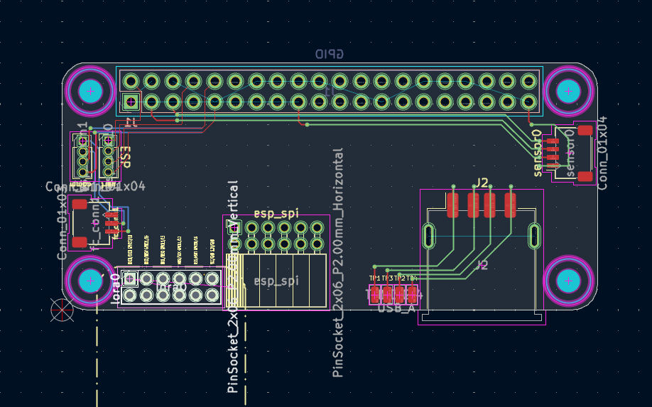

# Novex

Novex is an experimental embodied AI platform that connects AI, drones, spatial computing, VR, and wireless communication. NOVA allows a user to communicate with and command robotic agents through natural interaction while onboard systems handle perception, navigation, collision avoidance, and real-time control.

# Novex

### Embodied AI • Spatial Computing • Autonomous Robotics

**Novex** is an experimental embodied AI platform designed to connect artificial intelligence with the physical world through autonomous robotic systems.

Novex combines **AI reasoning, real-time control, computer vision, SLAM, spatial computing, VR, wireless communication, and robotic agents** into a single ecosystem.

The goal is simple:

> **Give AI the ability to perceive, understand, and interact with the physical world.**

---

## Architecture

Novex is designed as a layered system rather than one large AI model.

```text
                         HUMAN
                           │
                    Voice / Gesture
                           │
                           ▼
                    ┌────────────┐
                    │   PHONE    │
                    │ Controller │
                    └─────┬──────┘
                          │
                          ▼
                    ┌────────────┐
                    │    NOVA    │
                    │ AI / LLM   │
                    └─────┬──────┘
                          │
                     Mission Goal
                          │
                          ▼
                    ┌────────────┐
                    │  GO POLICY │
                    │ Fast Control│
                    └─────┬──────┘
                          │
                     Control State
                          │
                    ┌─────▼──────┐
                    │   SAFETY   │
                    │    LAYER   │
                    └─────┬──────┘
                          │
                    Controller Adapter
                          │
                    Reverse-Engineered
                       Interface
                          │
                          ▼
                         DRONE
                    ┌─────┴─────┐
                    │           │
                 Cameras       IMU
                    │           │
                    └─────┬─────┘
                          ▼
                   State Estimation
                          │
                          └──────→ GO
```

---

## Robotic Agents

Novex uses robotic agents as the physical embodiment of the system.

A drone can contain:

* Stereo or multiple cameras
* IMU
* Onboard computing
* Wireless communication
* Battery monitoring
* Spatial perception
* Local safety systems
* Real-time control software

The drone itself does not need to understand natural language. It receives structured missions and continuously executes them through its onboard control system.

---

## GO — Fast Control Policy

GO is Novex's lightweight real-time control layer.

Instead of using a large language model for every control decision, GO continuously processes the drone's current state and mission objective.

```text
Sensors
   │
   ▼
State Estimation
   │
   ├── Position
   ├── Velocity
   ├── Orientation
   ├── Target
   └── Obstacles
          │
          ▼
       GO Policy
          │
          ▼
 Controller Values
          │
          ▼
 Safety Layer
          │
          ▼
 Drone Interface
```

GO is intended to operate at a much higher frequency than the high-level reasoning system.

This separates **reasoning** from **reflexive control**.

---

## Controller Interface

Novex can interface with existing robotic platforms through hardware-specific controller adapters.

The fast policy produces normalized control values, which are then translated by an adapter into the appropriate control representation for the target platform.

```text
GO
 ↓
Normalized Control State
 ↓
Controller Adapter
 ↓
Protocol / Signal Encoding
 ↓
Robot
```

This abstraction allows the same control architecture to potentially support different robotic platforms without rebuilding the AI system.

---

## Spatial Perception

Novex uses computer vision and sensor fusion to estimate the physical environment.

Stereo cameras can provide depth information while visual odometry and inertial measurements help estimate movement.

```text
Stereo Camera ──┐
                ├──→ Sensor Fusion
IMU ────────────┘
                      │
                      ▼
              Position / Velocity
                      │
                      ▼
                  World Model
```

The system can use this information for navigation, spatial interaction, and collision awareness.

---

## Safety & Collision Detection

Safety is intentionally separated from high-level AI.

The AI may request an action, but an independent safety layer can reject or modify unsafe commands.

```text
             AI
              │
              ▼
        Desired Motion
              │
              ▼
       ┌──────────────┐
       │    SAFETY    │
       │    SYSTEM    │
       └──────┬───────┘
              │
        Safe / Blocked
              │
              ▼
           Control
```

This prevents a faulty model or incorrect command from directly determining physical behavior.

---

## NoRA

**NoRA** is the infrastructure and communication layer surrounding Novex.

Rather than being solely a drone-control protocol, NoRA is designed to connect:

* Homes
* Charging stations
* Relay nodes
* Robotic agents
* Local services
* User devices

The phone acts as the primary human controller, while NoRA provides communication between the wider ecosystem.

---

## Autonomous Infrastructure

Novex can incorporate charging and docking stations into the robotic ecosystem.

A drone can:

1. Complete a mission
2. Monitor battery state
3. Determine whether it should return
4. Navigate toward a known station
5. Dock
6. Recharge
7. Remain available for future missions

This allows robotic agents to operate as part of an ecosystem rather than as isolated devices.

---

## VR & Spatial Computing

VR provides another interface into the Novex environment.

A spatial representation of the physical world can potentially be viewed through VR, allowing an operator to understand:

* Robot positions
* Environmental geometry
* Camera perspectives
* Missions
* Paths
* Obstacles
* System status

The long-term goal is to make the boundary between the physical and digital environments increasingly transparent.

---

## High-Level AI

Novex's high-level AI can be connected to an LLM for natural interaction and mission planning.

For example:

```text
"Keep Drone 1 near me and have
Drones 2 and 3 orbit around it."
```

The LLM can translate the request into a structured mission.

The mission is then passed to the real-time control system.

The LLM **plans**.

GO **executes**.

The safety system **guards**.

---

## Long-Term Vision

Novex is ultimately exploring a larger question:

> **What happens when AI is no longer limited to a screen?**

Instead of an AI existing only inside a computer, Novex explores an AI that can:

**See → Understand → Plan → Act → Observe → Adapt**

through a network of physical robotic agents.

The long-term vision is a distributed embodied intelligence platform where **humans, AI, robots, spatial environments, and infrastructure operate together as one system.**

---

## Project Status

Novex is an experimental research and development project.

Current areas of development include:

* [ ] Drone hardware platform
* [ ] Controller interface
* [ ] Onboard computing
* [ ] Stereo vision
* [ ] State estimation
* [ ] Collision detection
* [ ] GO policy
* [ ] Nova AI integration
* [ ] NoRA communication layer
* [ ] Charging/docking system
* [ ] VR spatial interface
* [ ] Multi-agent coordination
* [ ] Swarm experimentation

---

## Safety

Novex involves physical robotic systems.

Early development should prioritize simulation, bench testing, controlled environments, low-energy experiments, and independent safety systems before attempting autonomous flight.

The objective is to make the system **predictable before making it autonomous.**

---

## Philosophy

Novex is built around one principle:

> **Don't make one giant AI do everything. Build systems that specialize.**

A fast controller handles reflexes.

A spatial system handles perception.

An AI handles reasoning.

A communication layer connects everything.

A safety system keeps the physical world from becoming a debugging session.

And the human remains in control.

## Schematics



[](<https://kicanvas.org/?repo=https://github.com/xisolatedev/Novex/blob/main/board_cad/novex_rasp_hat/novex_rasp_hat.cad>)

Firmware isnt fully tested to hardware
V2 Prototype underway.
-Ommidirectional Mircophone Array
-4G Connection
-Mesh Network Worker / Tower Brodcaster